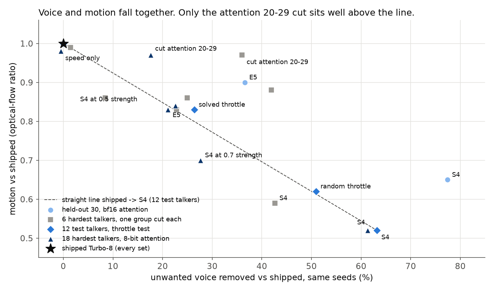

# Weight-space programming edit: MiniMax H3 Turbo LoRA

MiniMax H3 is a joint audio and video diffusion transformer (DiT). Its community **Turbo-8** speed LoRA samples in 8 steps instead of 20. That makes clips about 2x faster and about half the price (58.6 s vs 120.3 s per 3 s clip on one RTX 5090).

It has an annoying side effect. On prompts that ask for a silent reaction, Turbo-8 often adds a voice: a word, or seconds of gibberish, usually over a closed mouth. A production scan flagged **538 of 1,586 Turbo-8 clips (34%)**.

**The question we tested.** The full 20-step model, with no speed LoRA, handles silence far better. On the same 30 held-out prompts and seeds it talks on 3 clips, against 9 for Turbo-8, with 0.38 s of stray voice per clip against 0.93 s. So the voice looks like a side effect of distilling the model into a fast LoRA. Could **weight-space programming** remove that side effect by editing the LoRA's weights directly, with no gradients, no retraining and no extra inference cost?

Mostly, yes. One edit cuts the stray speech 4.3x, though it costs some motion. Along the way we also made the same Turbo-8 lane **1.58x faster** by switching attention to 8-bit.

> **Status: early findings and a proof of concept.** Samples are small and the motion cost is not solved. We think it is worth exploring in more depth: the block map below already points to a cleaner target. See [Status](#status).

---

## The fix, side by side

Same prompt and seed in each pair. Press play with sound on. The shipped clip plays first with its sound, then the S4 clip plays with its sound.

https://github.com/user-attachments/assets/462f13c8-cff8-43de-878a-f8d545af71df

https://github.com/user-attachments/assets/7cd3c078-63d0-4c2d-a168-85f5ff750d62

https://github.com/user-attachments/assets/39a045cf-4755-4f3e-a983-b6adf965a715

https://github.com/user-attachments/assets/077ee24f-e791-41e0-9db1-8144456489a3

https://github.com/user-attachments/assets/d689737a-5bdf-4a55-8da5-5ba77c00589a

The cost, shown honestly. On some seeds the edit also stills the motion:

https://github.com/user-attachments/assets/340a8658-243a-48ff-a16b-d6967466ce2b

---

## Results

**The S4 edit cuts unwanted speech 4.3x. Clips that clearly talk drop 9x.**

It targets voice and talking only. Background sound mostly stays: outside the voice spans it is a median 8.3 dB quieter, and clearly quieter (over 10 dB) on 13 of 30 clips.

30 held-out silent prompts from production, same seeds both ways. S4 was picked on a separate dev set (this set had earlier scored the agent's first edit, see [Limitations](#limitations)):

| | Shipped Turbo-8 | With S4 | Change |
|---|---|---|---|
| Clips that clearly talk (1.2 s or more) | 9 of 30 | 1 of 30 | **9x fewer** |
| Unwanted speech per clip | 0.93 s | 0.21 s | **4.3x less** |
| Lines that should be spoken (10 scripted) | 10 of 10 | 10 of 10 | still spoken |
| Motion | 1.00 | 0.65 | **the cost: 35% less** |
| Clean clips that stayed clean | 10 of 10 | 9 of 10 | one 0.25 s blip |

- It holds on 55 fresh seeds: voiced clips fell from 50 to 15. 35 went silent, none started talking (sign test p = 6e-11).
- A random edit matched to the size of the agent's first edit (E5) changed nothing (0.93 s → 0.94 s). S4 itself has no size-matched random control yet.
- Long talking of 4 s or more is not the LoRA's fault. The 20-step model with no LoRA talks about as long on 3 of 4 such seeds, so no LoRA edit can fix that part.

---

## What the edit is

H3 has 50 DiT blocks. The LoRA's weight change is nearly rank 1: in the largest modules, one direction holds 98.7-99.9% of the change. Each edit removes that top direction, in chosen modules only. S4 does it in 120 modules, about 63.5% of the LoRA's total weight change (adaLN modules untouched). The base model is never touched, and the edited LoRA loads like the original.

| Edit | Blocks | Modules | Speech cut (test set) | Motion kept (same set) |
|---|---|---|---|---|
| **S4** | 20-49 | qkv, out, fc1, fc2 | 4.3x (held-out 30) | 0.65 |
| E5 (the agent's pick) | 30-49 | qkv | 1.6x (held-out 30) | 0.90 |
| Attention 20-29 | 20-29 | qkv, out | 1.2x (18 hardest talkers) | 0.97 |

- The speech and the motion ride on the same direction. Every edit except attention 20-29 lands near one straight line: more speech removed means more motion lost. Attention 20-29 keeps motion (0.97) but removes only 18% of the speech.
- A 6-group throttle tried to keep the speech-heavy parts and spare the motion-heavy ones. It failed its pre-registered bar and landed on the same line.
- Half and 70% strength versions of S4 don't escape it either. Most of the speech cut only arrives near full strength.

### How it was found

We followed Exp 8 of *Sparks of Weight-Space Programming* (Takehi, Teoh, Zhang, Khattab, Nov 2026). An LLM agent gets a Python kernel over the LoRA weights and a small render budget. It may read weights, stage edits and render clips. It may not take gradients.

- With a budget of 25 renders, the agent ruled out the audio, text and video modulation rows. It then found that removing the top direction of the late blocks' attention and MLP silenced its practice clips.
- It submitted E5, the narrowest version that worked.
- We then scripted 4 wider variants of its finding and picked S4 on a separate 10-clip dev set. So S4 is the agent's direction, chosen wider by us. The 55 fresh seeds are its clean test.

---

## Speed: 8-bit attention

At H3's 22,507 tokens per clip, attention is about 67% of each Turbo-8 step. The weight matrices are only 23%. So attention precision is the speed lever.

| Turbo-8, same LoRA, same 8 steps | Shipped | 8-bit attention | Change |
|---|---|---|---|
| Full wall time per 3 s clip | 58.6 s | 37.1 s | **1.58x faster** |
| Cost per clip ($0.55/h GPU) | $0.0090 | $0.0057 | **37% cheaper, 1.58x more clips per dollar** |
| Quality | | | colour matched on 20 prompts; face sharpness 7% lower on held-out; voice matched on 24 clips (held-out voice not yet scored) |

- Why plain 8-bit and not SageAttention: SageAttention2 runs at the same clip speed but has 2x the attention error (3.9% vs 1.9%). SageAttention3 (4-bit) is the fastest per call, 3.5x vs stock, but its 19% attention error wasn't worth it.
- It is ComfyUI's built-in INT8 attention, switched on by a config key. No new weights. A kernel guard confirmed it ran in all 50 blocks.
- S4 stacks on top with no speed cost: 26.4 s vs 26.1 s sampling.
- 4-bit weights (NVFP4) save only about 2 s per clip (2.1 s measured), because the weights are not the bottleneck. Their value is memory: 19.9 GB vs 34 GB.

---

## Skin: saturation and waxy faces

We also checked whether quantizing to 4-bit damages skin. It does, and the damage maps to two kinds of layer:

| 20 steps, 6 broken-face prompts | Frame saturation | Face sharpness |
|---|---|---|
| 8-bit weights (reference) | 72.6 | 157 |
| 4-bit weights (NVFP4) everywhere | +25% (orange, oversaturated) | 1.30x (over-sharpened, waxy) |
| 4-bit, but attention qkv kept at 8-bit | +6% | 1.33x |
| 4-bit, but qkv and out_proj kept at 8-bit | +4.5% | 0.96x |

- qkv drives the oversaturation. out_proj drives the waxy over-sharpening.
- Keeping those 100 of 250 modules at 8-bit restores 8-bit-level skin for about 3% more sampling time.
- A weight-edit fix that would keep everything at 4-bit was specced and parked, because 4-bit only saves about 2 s per clip here.

---

## Where the speech lives: LoRA block map

We switched the speed LoRA off in one 5-block slice at a time and rendered the 6 hardest talkers (never used for fitting). Every arm is paired with a fresh shipped render on the same box and seed (2.65 s mean voice).

| LoRA off in | Speech | Silent of 6 | Motion | Face sharpness |
|---|---|---|---|---|
| Blocks 0-24 (each slice) | −4% to +3% | 0 | 0.99-1.01 | 0.95-1.02 |
| **Blocks 25-29** | **−34%** | 1 | **0.99** | 0.97 |
| Blocks 30-34 | −27% | 1 | 0.95 | 1.10 |
| Blocks 35-39 | −29% | 1 | 0.81 | 1.08 |
| Blocks 40-44 | −34% | 2 | 0.87 | 1.05 |
| Blocks 45-49 | −10% | 0 | 0.87 | 0.70 (audio broken) |
| Attention only, blocks 25-29 | −21% | 0 | 1.01 | 1.02 |
| MLP only, blocks 25-29 | +3% | 0 | 0.98 | 1.00 |

- The first half of the network (blocks 0-24) adds no speech.
- Switching off blocks 25-29 is the cleanest speech cut found so far: −34% speech at 0.99 motion. S4 at half strength gave −23% at 0.84 motion.
- In blocks 25-29, attention alone gives −21% and the MLP alone gives nothing. The rest of the cut likely sits in the modulation (adaLN) weights, which is untested.
- Blocks 40-44 cut as much speech but cost motion. The last 5 blocks carry fine detail and audio texture.
- Only 6 seeds. Combining blocks 25-34 was not tested.

---

## What did not work

| Idea | Result |
|---|---|
| Edit only the audio output head (cannot touch video) | Motion untouched, but speech fell only 3% |
| Crosscoder speech feature at block 30, step 1 of 8 | Best feature cut speech 3.7%; random control −2.4% |
| Light text encoder (truncate + closed-form fit) | Failed its accuracy gate; text encode is only 1.8 s of 37 s anyway |
| Cached S4 delta on audio tokens (captured once, added at run time) | Silenced all 6 talkers but wiped room sound too (−24 dB); a random push of the same size did the same. Not speech-specific. Video untouched (motion 0.94-1.01) |

The audio-head and crosscoder results point the same way. Step-1 activations barely predict voice, which suggests speech forms in later steps, spread over blocks 31-44 (untested).

---

## Status

Done 2026-11-16:

- [x] **LoRA speech map.** Switching the LoRA off in blocks 25-29 is the cleanest cut so far (−34% speech at 0.99 motion, 6 seeds). See above.
- [x] **Cached speech-off toggle.** Failed: at strength 1-2 it flattens all audio, and a random control does the same.

To do:

- [ ] **Blocks 25-34, attention only, on more seeds.** Combine the two clean slices and test on 30 held-out prompts.
- [ ] **Cached delta at low strength (0.1-0.5).** Check whether speech goes before room sound, with a random control at each strength.

- [ ] **Crosscoder, aimed right.** Retrain it at the blocks and steps the map points to, to find a speech switch that spares motion. Then bake the winner into the LoRA weights.

---

## Where this could go with text LLMs

The closest analogue for language models is teacher-student repair. On H3 the student is the fast Turbo-8 LoRA and the teacher is the full 20-step model. We used the teacher as the reference for what "correct" looks like (it stays silent where the student babbles), then edited only the student's weights toward it.

The same pattern fits text LLMs:

- **Teacher:** the full-size, full-precision model.
- **Student:** a quantized, distilled or cheaper inference model that picked up quirks along the way, like format slips, wrong habits in code or arithmetic errors.
- **Repair:** a weight-reading agent compares the two, finds the few weight directions where the student drifts, and edits them, with no gradients and no retraining. The source paper's authors used this kind of weight-space programming to improve math. Coding and other checkable tasks are the obvious next targets.
- **Cheaper to search:** one H3 render costs about 40 s of GPU time, while one text eval takes well under a second. So the agent could run hundreds of edit-and-test turns, not 25.
- **Controls carry over:** a size-matched random edit, a held-out set the agent never sees, and paired seeds.

---

## Limitations

- Small samples: 30 held-out prompts, 55 fresh seeds, 10 scripted lines, 18 hard talkers, one seed per prompt.
- One model, one LoRA, one prompt family, one GPU (RTX 5090).
- Clips were rendered at 768x1344, 73 frames, 24 fps (about 3 s; 7 production prompts kept their own lengths, up to 107 frames) to keep runs fast, below a 1080x1920 production render. Timings are at that size. The clips in this README are shrunk to 360 px wide; scoring used the full renders.
- Voice is measured with a voice detector (Silero VAD), not speech recognition. Quality checks are statistics, not a blind human panel.
- S4's pre-registered pass bar is not fully met. The speech target was met. The skin target (within 5%) was not measured as specified: its closest proxy, fine detail, fell 24%. Word accuracy was not assessed. Video is visibly worse on some hard talkers.

---

## References

- Takehi, Teoh, Zhang, Khattab. *Sparks of Weight-Space Programming.* Blog post, 2 Nov 2026. Exp 8 is the protocol mirrored here.
- N. S. Ahmed. *Can an LLM Actually Reason and Program about Neural Network's Weights or is it just memorization on steroids? Exploring "Weight-Space Programming".* arXiv:2611.08070, Nov 2026.
- Zhang et al. *SageAttention*, *SageAttention2* and *SageAttention3*.
